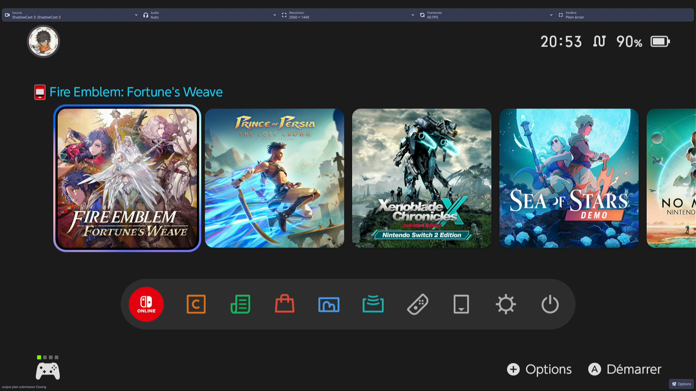
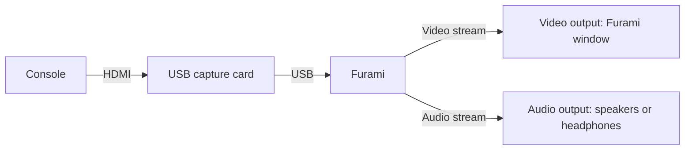

<h1 align="center">Furami</h1>

<p align="center"><strong>Your game console, on your Linux desktop.</strong><br>
Connect a USB capture card to watch your console and hear its audio in one desktop app.</p>

<p align="center">
  <a href="#about">About</a>
  ·
  <a href="#highlights">Highlights</a>
  ·
  <a href="#get-started">Get started</a>
  ·
  <a href="#controls">Controls</a>
  ·
  <a href="#limitations">Limitations</a>
</p>

<p align="center">
  <a href="https://github.com/Anthodev/furami/releases"></a>
  <a href="https://github.com/Anthodev/furami/actions/workflows/ci.yml"></a>
  
  <a href="LICENSE"></a>
  
</p>

> [!NOTE]
> Tested on Fedora with KDE Plasma and Hyprland (Wayland); other distributions and desktops are untested.



<a id="about"></a>

## 📺 About

Furami is a Linux app for streaming your console through a USB capture card, with a focus on **image quality** and **very low latency**. Connect your console to the card over HDMI and the card to your PC over USB, then watch and listen directly in Furami.



<a id="highlights"></a>

## ✨ Highlights

- **Automatic stream setup.** Select a source and Furami configures the stream for your capture device, restoring its saved settings when available.
- **Settings remembered per device.** Your resolution, frame rate, input format and renderer choices come back with that capture source.
- **Choose resolution, framerate and format.** Pick them in the window — YUYV, NV12 and MJPG are supported — and each change applies immediately.
- **Windowed or fullscreen.** `F11` toggles fullscreen for the Furami window.
- **Listen on the output you choose.** Audio plays on the output you pick, and your desktop mixer and output selection are left untouched.
- **Pause, volume and mute.** `Space` pauses and resumes, and the volume slider, mouse wheel, arrow keys and mute button act on Furami's playback only.

<a id="get-started"></a>

## 🚀 Get started

| Requirement | Notes |
| --- | --- |
| Console and capture card | A game console on HDMI and a USB capture card that exposes a UVC (V4L2) capture node. |
| Operating system | Linux x86_64. See the [portability notes](packaging/appimage/PORTABILITY.md). |
| Graphics | A host Vulkan loader and a working driver for your GPU. Software rendering is not supported. |
| Wayland sessions | A running XWayland server and a reachable `DISPLAY`. |
| Audio (optional) | An existing host PipeWire session providing `pw-loopback` and `pw-metadata`. Video-only viewing works without audio. See the [media recipe](packaging/media/README.md#host-audio-helpers-runtime-requirement-audio-enabled-only). |

Download the AppImage from the [Releases page](https://github.com/Anthodev/furami/releases) and check it against the `SHA256SUMS` file published alongside it. Then make the file executable — for example, right-click it in your file manager, open **Properties → Permissions** and enable **Allow executing file as a program** — and launch it by double-clicking.

Then everything happens in the window:

1. Connect the console to the capture card with HDMI, and the card to the PC over USB.
2. Select **Source**.
3. Adjust **Résolution** and **Framerate** if the automatic choice is not what you want.
4. Select the **Audio** output you want to listen on.

#### If the AppImage does not mount

Rename the downloaded file to `Furami.AppImage`, then extract it without FUSE:

```sh
./Furami.AppImage --appimage-extract
./squashfs-root/AppRun
```

<a id="controls"></a>

## 🎮 Controls

Move the pointer over the window to reveal the ribbon. **Source**, **Résolution** and **Framerate** select the capture immediately; **Audio** chooses the playback output independently of capture. Open **Options** for capture actions, compatible input formats and renderer controls.

| Input | Action |
| --- | --- |
| `Space` | **Mettre en pause** / **Reprendre** at video focus, outside text entry and popups |
| `F11` | Same as **Fenêtre** / **Plein écran**, for the Furami window only |
| `Esc` | Open **Réglages** when no popup is open; otherwise dismiss the ordinary popup, without leaving fullscreen |
| `Tab` / `Shift+Tab` | Move focus between controls |
| **Volume slider** | Furami's playback volume, 0–100, immediate; arrow keys change it by 1 point |
| **Wheel over the video or the volume rail** | Change playback volume by 5 points per notch, bounded to 0–100 |
| **Mute / Unmute** | Furami's playback output only |
| **Reconnecter la capture** in **Options** | Retry the last selection, or wait for an ongoing reconnection |

Text entry takes priority: shortcuts use unmodified presses, ignore auto-repeat and never act globally — `Esc` never leaves fullscreen and never dismisses a mandatory decision. The wheel adjusts volume only over the video or the volume rail, while Furami is active and no popup is open. Volume and mute stay independent, and neither touches your desktop mixer or output selection.

Pausing freezes the picture and silences the output, and resuming jumps to the console's current scene. **Audio** prefers an available EasyEffects output when Auto routing is active, otherwise the current default output; choosing a concrete output switches to manual routing. If a manually chosen output disappears, the sound stops with no automatic fallback and you select one again. This playback output is not the capture card's audio input.

**Reconnecter la capture** reconnects the last applied selection when the same card returns; an ambiguous match waits for your choice.

## 🔧 Preferences

Furami keeps one settings file: a saved profile per capture card, plus global preferences that source changes never replace.

| Scope | Contents |
| --- | --- |
| Per-card profile | Resolution, framerate, input format, renderer settings and capture audio, restored when that source is selected again. |
| Global preferences | Output routing, playback volume, mute, fullscreen, statistics visibility and diagnostic-logging opt-in. |

<details>
<summary>Settings file</summary>

The file lives at `$XDG_CONFIG_HOME/furami/settings.json`, or `$HOME/.config/furami/settings.json` when that variable is unset or empty; an invalid location is reported rather than replaced with a guessed path. A corrupt, invalid or newer-version file is preserved, and all automatic saves stay blocked until you confirm **Reset saved file** in the app, which clears the saved profiles while keeping current global preferences. Older builds cannot read the current format — before downgrading, keep a copy and use a separate configuration.

</details>

## 🔎 Troubleshooting and privacy

Furami can write diagnostic logs and a sanitized session report that help describe a problem without a debugger. Logging is **off by default**, and you can enable **Activer les journaux de diagnostic** in **Options → Réglages → Préférences**; the change takes effect immediately, and existing logs are kept when you turn it off. Review a report before sharing it, because it keeps technical audio endpoint names, device IDs and capture modes while omitting raw device paths and USB identity.

<details>
<summary>Where logs live</summary>

`$XDG_STATE_HOME/furami/logs`, or `$HOME/.local/state/furami/logs` when that variable is unset or empty. Furami keeps one active log file and up to four older files, each at most 1 MiB.

</details>

<a id="limitations"></a>

## 🚧 Limitations

- **Tested on Fedora with KDE Plasma.** Other distributions and desktops have not been tested. Hardware Vulkan is required, along with XWayland in Wayland sessions.
- **Capture shutdown and recovery still need work.** Closing a capture session can crash. Saving and restoring settings during playback, adapting saved settings on startup, and recovering picture and sound after unplugging the card still need testing.
- **Performance measurements are pending.** Latency, audio/video synchronisation and long-session stability have not been measured; very low latency is a design priority, not a guaranteed figure.

## 🔨 Building from source

Furami is built from source with Rust and Qt. The [media recipe](packaging/media/README.md) covers the pinned dependencies; the [AppImage documentation](packaging/appimage/README.md) covers application builds and packaging.

## Acknowledgements

Furami's overlay icons come from [Tabler Icons](https://tabler.io/icons) (see [qml/icons/LICENSE-tabler.txt](qml/icons/LICENSE-tabler.txt)), and its default palette is inspired by [Catppuccin](https://catppuccin.com/) Macchiato.

## Contributing

Contributions are welcome through issues and pull requests against the `develop` branch.

## 📄 License

Furami-authored source is [MIT](LICENSE) — the badge above reports that source license only. The pinned media build includes GPL mpv/FFmpeg and LGPL libplacebo/Qt, so a combined executable is not MIT-only; the [core license audit](packaging/media/LICENSE-AUDIT.md) records build flags and distribution obligations for redistribution. The [RELINKING](packaging/appimage/RELINKING.md) notes and the [public material scope](packaging/appimage/README.md#public-material-scope) describe what a distributed image and its downloads do and do not carry.
